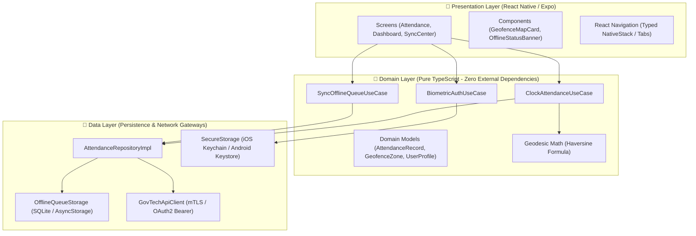

# 🇸🇬 GovTech Mobile Workforce — Cross-Platform React Native Architecture

[](https://github.com/arifrhm/react-native-govtech-mobile/actions/workflows/ci.yml)
[](https://www.typescriptlang.org/)
[](https://reactnative.dev/)
[](https://expo.dev/)
[](#offline-first-synchronization-engine)
[](https://opensource.org/licenses/MIT)

> **Production-grade cross-platform mobile client engineered for public sector field officers, government agency staff, and citizen service workflows.** Built with **React Native**, **Expo**, strict **TypeScript**, and **Clean Architecture (Domain-Driven Design)**, featuring hardware-backed biometrics, offline-first deterministic queuing, and geofenced attendance verification.

---

## 🏛️ System Architecture & Layer Boundaries

The codebase strictly adheres to **Clean Architecture** to decouple core enterprise business logic from UI frameworks, device sensors, and network dependencies.



---

## ⚡ Core Engineering Capabilities

### 1. 📍 Precision Geofencing via Haversine Geodesic Math
Attendance timestamps must be strictly verified against designated government facility boundaries. 
- Implements the **Haversine Formula** (`Earth Radius: 6,371,000m`) in pure TypeScript to compute great-circle distance between device GPS telemetry and authorized zone centers.
- Sub-meter accuracy threshold validation with automatic tamper-evident rejection when outside permissible radius.

### 2. 🔐 Hardware-Backed Biometric Verification
- Interfaces with iOS **FaceID / TouchID** and Android **BiometricPrompt** via `expo-local-authentication`.
- Sensitive session tokens and cryptographic signing keys are stored exclusively in the device's hardware-backed Secure Enclave / Keystore (`expo-secure-store`).

### 3. 🔄 Resilient Offline-First Synchronization Engine
Field operations frequently occur in underground facilities, tunnels, or maritime checkpoints with zero cellular connectivity:
- **Immediate Local Persistence**: Attendance and inspection records are serialized into a local SQLite queue before any network attempt.
- **Background Drain & Conflict Resolution**: When network connectivity is restored, the `SyncOfflineQueueUseCase` processes the pending queue in micro-batches with exponential backoff and idempotency keys to eliminate duplicate state mutations.
- **Automated Storage Hygiene**: Successfully synced records are retained for auditing and automatically purged after 48 hours to minimize local disk footprint.

---

## 📂 Codebase Layout

```
react-native-govtech-mobile/
├── .github/workflows/
│   └── ci.yml                      # Automated lint, typecheck, and unit test pipeline
├── __tests__/
│   ├── geofence.test.ts             # Haversine distance & geofence validation tests
│   └── offline_sync.test.ts         # Offline queue persistence and sync tests
├── src/
│   ├── domain/                     # Pure enterprise business logic
│   │   ├── models/
│   │   │   ├── Attendance.ts       # AttendanceRecord, Coordinate, SyncStatus
│   │   │   ├── Geofence.ts         # GeofenceZone & Haversine geodesic calculation
│   │   │   └── User.ts             # UserProfile & AuthSession
│   │   └── usecases/
│   │       ├── BiometricAuthUseCase.ts
│   │       ├── ClockAttendanceUseCase.ts
│   │       └── SyncOfflineQueueUseCase.ts
│   ├── data/                       # Repositories & datasources
│   │   ├── datasources/
│   │   │   ├── GovTechApiClient.ts # API client with token interceptors
│   │   │   ├── OfflineQueueStorage.ts # Local queue persistence
│   │   │   └── SecureStorage.ts    # Hardware secure storage wrapper
│   │   └── repositories/
│   │       └── AttendanceRepositoryImpl.ts
│   └── presentation/               # UI components & screens
│       ├── components/
│       │   ├── GeofenceMapCard.tsx
│       │   └── OfflineStatusBanner.tsx
│       └── screens/
│           └── AttendanceScreen.tsx
├── app.json                        # Expo app configuration & permissions
├── package.json
└── tsconfig.json
```

---

## 🧪 Automated Test Suite

Run the verified test suite with zero external mock flakiness:

```bash
# Run unit tests natively
node --experimental-strip-types --test __tests__/*.test.ts
```

Test coverage includes:
- ✅ Exact geodesic distance calculation across identical coordinates.
- ✅ Positive geofence verification within authorized boundary radius.
- ✅ Rejection and alerting when GPS telemetry falls outside authorized perimeter.
- ✅ Offline record queuing with `PENDING` state serialization.
- ✅ Queue replay and status transition to `SYNCED` upon network reconnection.

---

## 🚀 Getting Started

### Prerequisites
- Node.js `>= 18.0.0`
- npm `>= 9.0.0`
- Expo CLI (`npm install -g expo-cli`)

### Installation & Run

```bash
# Clone repository
git clone https://github.com/arifrhm/react-native-govtech-mobile.git
cd react-native-govtech-mobile

# Install dependencies
npm install

# Start development server
npx expo start
```

---

## 👨‍💻 Engineering Profile & Contact

**Arif Rahman**  
*Senior Full Stack & Distributed Systems Engineer*  
- **Email:** [arif.rahman.rhm@gmail.com](mailto:arif.rahman.rhm@gmail.com)  
- **LinkedIn:** [linkedin.com/in/arifrahmanrhm](https://linkedin.com/in/arifrahmanrhm)  
- **GitHub:** [github.com/arifrhm](https://github.com/arifrhm)  
- **Portfolio:** [arifrahman.biz.id](https://arifrahman.biz.id)  
